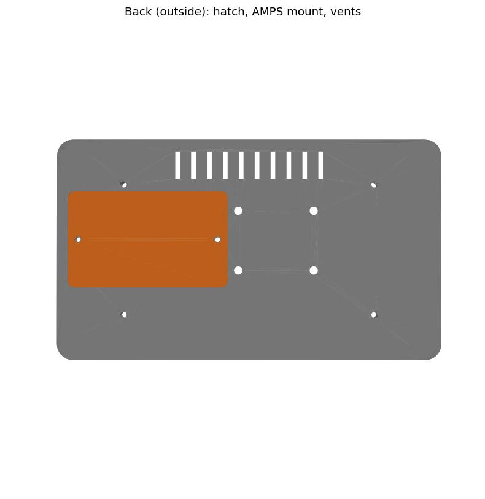
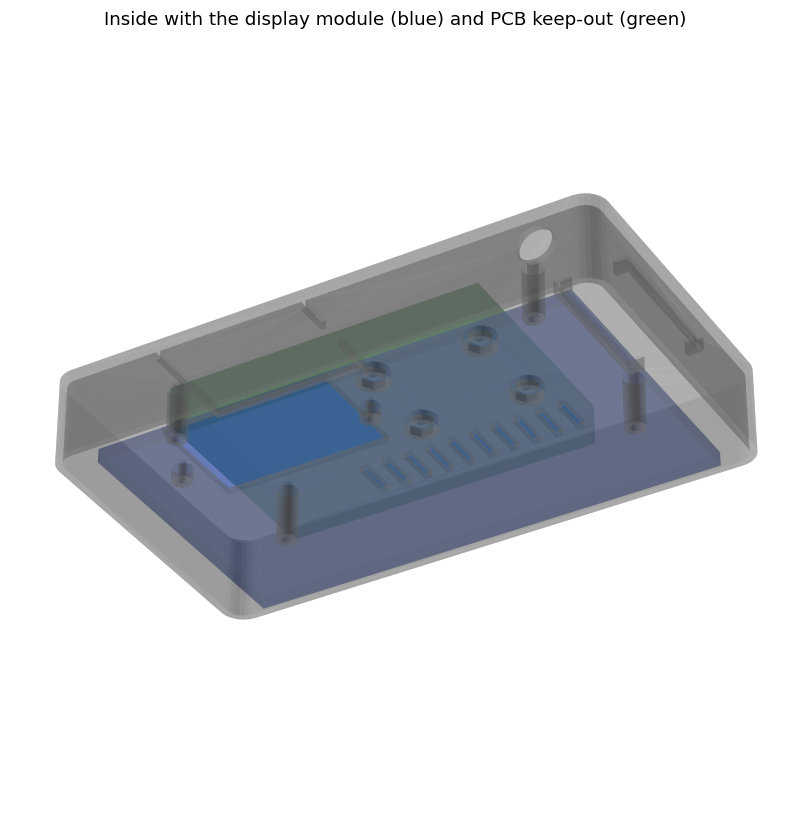

# FP_Dash back cover (FreeCAD)

A 3D-printable back cover for the Waveshare ESP32-S3-Touch-LCD-7. It turns
the bare display module into a dash unit with:
- a car connector;
- room for the 12 V → 5 V converter;
- an optional battery;
- a standard mount pattern.

| File | |
|---|---|
| `fp_dash_cover.py` | The model as a FreeCAD macro. It builds everything from a parameter table. |
| `FP_Dash_Cover.FCStd` | The generated FreeCAD document. Open it in FreeCAD. |
| `export/*.stl`, `*.step` | Ready to slice (STL), or to open in other CAD tools (STEP). |
| `render_preview.py` | Regenerates the pictures in `preview/`. |




**Status:** generated, not printed yet. The board positions come from
Waveshare's drawing (Rev1.2 board). The **thicknesses are guesses**: measure
them first (see *Before you print*).

## What the design does

**Fixing to the display.** The LCD's metal back has 4 brass M3 standoffs
(126.20 x 65.65 mm apart). The cover has 4 posts that land on them, and 4 M3
screws go through the cover into the standoffs. The cover's rim follows the
glass outline and stops 0.5 mm short of the glass. A 1 mm foam tape fills that
gap, so tightening the screws can't press on the glass.

**Inside, seen from behind:**

```
 ┌───────────────────────────────────────────────────────────┐
 │  o        vents ||||||||||                       o        │   o = M3 cover screws
 │ ┌─────────────────┐                            ┌──────┐   │
 │ │ service hatch   │      AMPS  + +             │ 12V  │   │
 │ │ UART/USB USB-C  │            + +             │ ->5V │   │
 │ │ SD card         │                            │ conv.│   │
 │ └─────────────────┘                            └──────┘   │
 │  o      ┌ battery ┐                              o        │
 │         └─────────┘                          (O) car conn.│ <- bottom wall
 └───────────────────────────────────────────────────────────┘
```

- **Service hatch** (orange, printed separately). It sits over the board's
  edge with both USB-C ports and the SD slot, held by 2 screws. Open it to
  flash over the UART port, or to take the SD card out.
- **Car connector** in the bottom wall, near the board's CAN header.
  Default hole: 12.2 mm, for a GX12 4-pin "aviation" connector.
- **Converter cradle:** two rails for a 12 V → 5 V module (sized for a
  43 x 21 mm LM2596 board), fixed with double-sided tape.
- **Battery bay:** a frame for a 1-cell LiPo pouch (50 x 34 mm).
  **Read the battery section before you use it.**
- **AMPS mount:** 4 x M4 holes, 30 x 38 mm, with M4 nut traps inside. This is
  the standard pattern of RAM-style ball mounts and many phone/tablet car
  holders, so you can choose the mount later.
- **Vents:** a row of slots at the top.

## Decisions (recommendations)

**Connector to the car: yes, 4 pins.** A connector means the dash comes out of
the car without cutting wires. Pins:

| Pin | Signal | |
|---|---|---|
| 1 | **KL15** | +12 V switched by the ignition. Use a 1 A fuse at the car side. |
| 2 | **KL31** | Ground |
| 3 | CAN-H | twisted pair with CAN-L |
| 4 | CAN-L | |

KL31 is ground and KL15 is the ignition-switched +12 V, so you need KL15 +
KL31 (not KL31 twice). **KL30** (permanent +12 V) is only worth a 5th pin if
you later want the dash to stay on briefly after ignition off, to close the
log files cleanly. That also needs a small power-hold circuit. With 4 pins
the firmware is already safe enough: files are flushed every 2 s.

If GX12 is too small, use **GX16 (16 mm)** or an **M12 4-pin panel
connector**: set `con_d` (and `con_body_d` / `con_body_l`) from its datasheet.
GX connectors must not be plugged in or out with power on.

**5 V supply.** The board takes 5 V on USB-C only and draws about 450 mA. Use a
12 → 5 V module rated **2–3 A** whose input range covers the car: **at least
8–36 V**. The car's 12 V spikes well above 14 V when the engine starts and on
load dumps. Plug its output into the board's **USB** port (the native one, not
used for data because its pins are CAN). Use a short USB-C cable, or a USB-C
plug wired to the module. The **UART** port then stays free for flashing.
- I have not checked the board's schematic for what happens with 5 V on both
  USB-C ports at the same time. Until you have, unplug the car side before
  connecting the laptop to the UART port.
- A 1 A fuse and a TVS diode (e.g. SMBJ24A) at the module input are cheap
  insurance.

**Battery: optional, and better left out in the car.**
- Hot cabin: a LiPo must not be charged above about 45 °C, and a parked car
  in the sun gets far hotter. The board itself is rated 0–65 °C.
- No real benefit: in the car the dash runs from KL15 anyway.

Use the bay for bench / portable use, or switch it off:
`BUILD_BATTERY_BAY = False` at the top of the macro.

If you buy one:
- **1 cell 3.7 V LiPo** with a **PH2.0** connector, ~1000–2000 mAh, e.g. size
  503450 (5 x 34 x 50 mm) or 103450.
- **Check the plug polarity against the board's markings before plugging
  in.** Hobby packs come with both polarities; swap the pins in the plug if
  needed.
- Enter its real size in `bat_l`, `bat_w`, `bat_t` (add 1 mm to the
  thickness for swelling).

**Where to buy in Romania** (search terms, check stock):
- Optimus Digital, Sigmanortec, Cleste, Robofun, eMAG marketplace, or TME
  (ships from Poland).
  - LiPo: "acumulator LiPo 3.7V 503450 PH2.0" / "1000mAh JST PH 2.0"
  - Connector: "conector GX12 4 pini"
  - Converter: "modul coborare tensiune 12V 5V 3A", or a "DC-DC step down
    8-36V USB-C" car module

## Before you print

1. **Measure with calipers** and enter the values in the spreadsheet (see the
   next section):

   | Parameter | What to measure |
   |---|---|
   | `lcd_t` | glass back face → metal plate surface |
   | `so_h` | height of the brass M3 standoffs above the plate |
   | `pcb_stack` | plate → top of the tallest part on the PCB, with the USB-C plugs and the CAN/battery plugs in |
   | `glass_r` | corner radius of the glass |
   | `lcd_x`, `lcd_y` | glass edge → plate edge (left and bottom, seen from behind) |

   The top gap between the wall and the LCD (`clear_top`) is only 1.8 mm
   with the drawing's numbers. If it measures less, reduce `wall` or move
   `lcd_y`.
2. Also measure the thread depth of the standoffs. `screw_len` (in the
   spreadsheet) is the length that gives 4 mm of thread. With 25.5 mm, buy
   **M3x25** (3.5 mm in the thread).
3. Rebuild and check: `freecad.cmd CAD/fp_dash_cover.py` prints the gaps and
   a collision check. It covers the cover against the display, the PCB, the
   standoffs, the battery, the converter, the connector and the screw heads.
   It must end with `CHECK OK`. It also rewrites the STL/STEP files.
4. **Test print first:** print only the first 5 mm of the cover (stop the
   print early), and check the rim and the posts against the real display.

**Printing:**
- **Material: PETG at least, ASA/ABS better.** PLA softens at about 55 °C and
  will warp in a parked car.
- Orientation: back face on the bed; the slicer turns the part over. Only the
  connector hole in the wall overhangs, and a 12 mm hole bridges fine without
  supports.
- Settings: 0.2 mm layers, 4 walls, 25–30 % infill.

**Parts list:**
- 4 x M3x25 (cover → standoffs)
- 2 x M3x8 (hatch; cut their thread into the 2.6 mm pilot holes)
- 4 x M4x10 + 4 x M4 nuts (mount)
- ~60 cm of 1 mm foam tape, 5 mm wide (rim)
- double-sided foam tape (converter, battery)
- the 4-pin connector, the converter, short wires (twist CAN-H/CAN-L)

## Using the model in FreeCAD

Open `FP_Dash_Cover.FCStd`. The model tree on the left:
- **Params:** the spreadsheet with every size.
- **Reference_display:** blue/green boxes standing in for the glass, LCD,
  standoffs, PCB, battery, converter, connector and screw heads. They are not
  printed. Their only job is to check that the cover fits around them.
- **Cover:** the printed part. Expand it to see how it is made:
  `Cover = Cover_body − Cover_holes`, and `Cover_body = Shell + posts + bosses
  + rails`.
- **Hatch:** the second printed part.

**Change something:**
1. Double-click **Params** and change a value, e.g. `depth_in` from 24 to 28.
2. Close the sheet and press **Ctrl+R** (recompute). Every feature updates,
   because its sizes are expressions such as
   `Params.lcd_t + Params.depth_in`. To see one: select a feature, find a
   property in the Data tab, and click the small blue **f(x)** icon next to it.

**Look inside:**
- Select **Reference_display** and press **Space** to show or hide it.
- **View → Clipping plane** to cut the view open.
- The **Measure** tool to check distances.

**Export for printing:** select **Cover**, then *File → Export… → STL Mesh*.
Do the same for **Hatch**. Or just run the macro headless (step 3 above).

## Learning FreeCAD with this model

FreeCAD can build solids in two ways, and this model uses the first:

1. **Part workbench, "CSG".** You build with primitive solids (box, cylinder,
   prism) and combine them with Boolean operations (fuse, cut). It's easy to
   script and to understand, so it suits a generated model like this one.
2. **PartDesign workbench, "sketch → feature".** You draw a 2D sketch with
   constraints, then **Pad** (extrude), **Pocket** (cut), **Fillet**,
   **Thickness** (shell), **Hole**. Most hand modelling is done this way.

Both read the same spreadsheet. A good learning path:

**Exercise 1: the hatch by hand (30 min)**
1. *PartDesign → Create body*, then *Create sketch* on the XY plane.
2. Draw a rectangle (rectangle tool). Add a **horizontal distance**
   constraint for its width. In the input box press **=** and type
   `Params.win_w + 2 * Params.hatch_boss_d + 6 mm`. The sketch now follows the
   spreadsheet. Numbers inside a formula need their unit (`6 mm`, not
   `6`), or FreeCAD reports a unit mismatch.
3. Add the height constraint the same way. Then add 2 circles of
   `Params.screw_d`, centred on the long middle line, at the boss positions.
4. Close the sketch and **Pad** it by `Params.hatch_t`. The circles become
   holes automatically, because closed shapes inside a sketch are cut out.
5. Optional: select the 4 vertical edges and **Fillet** them, 3 mm.

Compare it with the generated `Hatch`.

**Exercise 2: the cover shell in PartDesign**
1. Sketch the glass outline (192.96 x 110.76) with rounded corners. Use the
   *rounded rectangle* tool, or a rectangle plus 4 sketch fillets.
2. **Pad** it by the cover height (`Params.z_top - Params.rim_gap`).
3. Select the bottom face and use **Thickness** with `Params.wall`. This is
   the "shell" operation: it hollows the solid and removes the selected face.
4. Sketch 4 circles on the inside face for the posts, then **Pad** with
   *Type: Up to face* or a fixed length (`Params.post_len`).
5. Use the **Hole** feature for the M3 holes: it knows standard screw sizes
   and counterbores.

**Exercise 3: your own feature.** For example, add a cable gland hole in the
side wall: sketch on the wall face, draw a circle, then **Pocket** *Through
all*.

**Tips that save time:**
- Constrain sketches fully: they turn green. Under-constrained sketches jump
  around when values change.
- Name things (F2). Expressions use names, and `post_len` is easier to read
  than `Pad003`.
- Reference faces carefully. If a feature hangs on "Face6" and you change
  something earlier, the face number can change: this is FreeCAD's
  "topological naming" issue. Base sketches on the body's origin planes where
  possible, as this model does.
- Use **Edit → Undo**; you can't break anything.

## Changing the generated design

The macro `fp_dash_cover.py` is ordinary Python and is meant to be read:
- the parameter table is at the top;
- `build()` creates the features, each with a comment;
- the switches `BUILD_BATTERY_BAY`, `BUILD_BUCK_CRADLE` and `BUILD_VENTS` turn
  parts on and off.

Running it again recreates `FP_Dash_Cover.FCStd` and the exports, so any hand
edits made in that file are lost. Either change the macro and rerun it, or
stop using the macro and continue by hand in FreeCAD.
